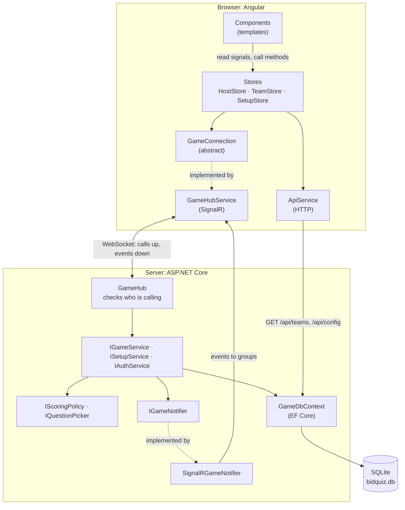
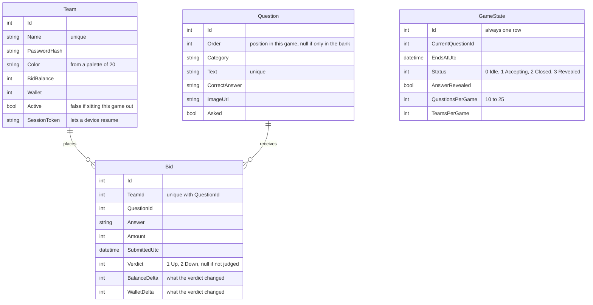
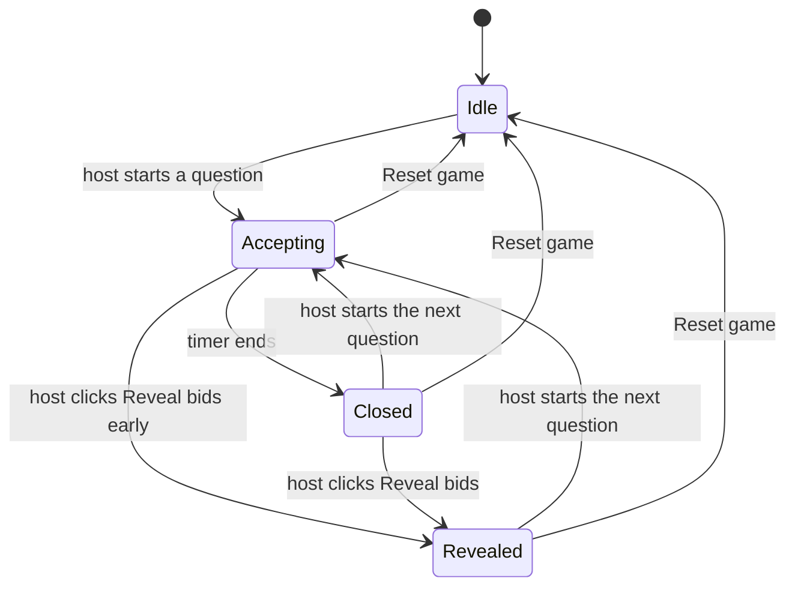
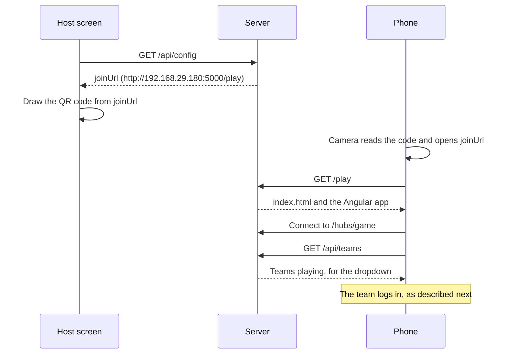
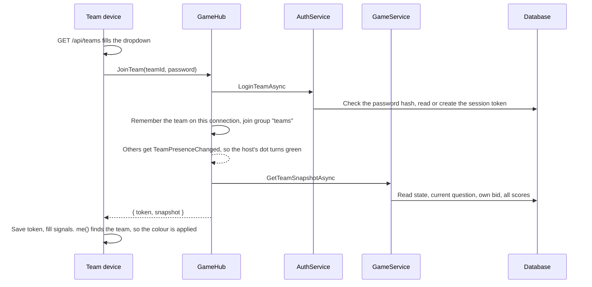
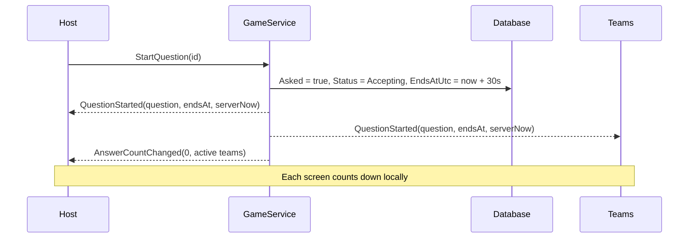
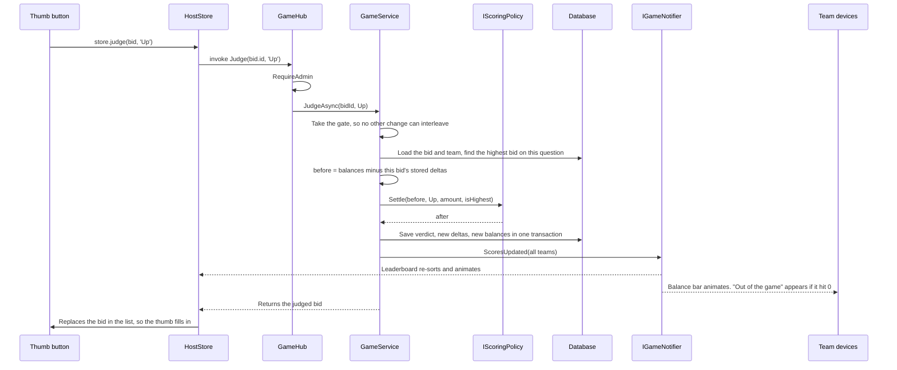

# Bid Quiz

A live bidding quiz. The host runs it on a projector laptop and teams play on their phones or laptops. Teams guess Hollywood and Bollywood movies from a short description, and bid on how sure they are.

- **Server:** ASP.NET Core 10, SignalR, EF Core with SQLite (`/server`)
- **Client:** Angular 22 with signals (`/client`), built into `server/wwwroot`
- **Tests:** xUnit (`/tests/BidQuiz.Tests`)

**Contents:** [Run](#run) · [Game rules](#game-rules) · [Set up a game](#set-up-a-game) · [The screens](#the-screens) · [Architecture](#architecture) · [Data model](#data-model) · [How teams and questions are picked](#how-teams-and-questions-are-picked) · [What is read from the database](#what-is-read-from-the-database) · [How the UI gets its data](#how-the-ui-gets-its-data) · [The whole workflow](#the-whole-workflow) · [Why realtime stays reliable](#why-realtime-stays-reliable) · [Configure](#configure) · [Test](#test) · [Develop](#develop) · [Deploy to Azure](#deploy-to-azure-app-service)

## Run

Requires the .NET 10 SDK and Node (built and tested on Node 24).

```
cd server
dotnet run
```

The first run installs the npm packages and builds the Angular app, so it takes a minute or so. The console then prints both URLs:

```
  Host screen:  http://localhost:5000/host
  Team join:    http://192.168.29.180:5000/play
```

1. Connect the laptop to the venue Wi-Fi **before** starting, so the right LAN address is found.
2. Open the host screen, log in and click **Start show**. The QR code contains the team join URL.
3. If phones can't connect, allow port 5000 through Windows Firewall. Some guest Wi-Fi networks block device-to-device traffic. If so, use a phone hotspot or deploy to Azure.

### Passwords

These are the defaults for a new database:

| Login | Password |
|---|---|
| Admin (host screen) | `change-me` |
| The Projectionists | `reel-1` |
| Velvet Ropes | `reel-2` |
| Popcorn Bandits | `reel-3` |
| Silver Screens | `reel-4` |
| Matinee Idols | `reel-5` |
| Final Cut | `reel-6` |
| Golden Reels | `reel-7` |
| Directors Cut | `reel-8` |
| Box Office Kings | `reel-9` |
| Red Carpet Crew | `reel-10` |
| Spotlight Squad | `reel-11` |
| Blockbusters | `reel-12` |
| Plot Twisters | `reel-13` |
| Scene Stealers | `reel-14` |
| Reel Rebels | `reel-15` |
| Green Room Gang | `reel-16` |
| Encore Crew | `reel-17` |
| Cliffhangers | `reel-18` |
| Silver Linings | `reel-19` |
| Opening Night | `reel-20` |

The admin password is `Game:AdminPassword` in `server/appsettings.json`. **Change it from `change-me` before the show.** Team passwords come from `server/seed/teams.json`, and the setup page can change them. This table doesn't update when you do, because the database stores only a hash of each password.

## Game rules

Each team has two balances:

| Balance | Starts at | What it is | Lowest value |
|---|---|---|---|
| **Bid Balance** | 10,000 | The money a team bids with | 0 |
| **Wallet** | 0 | The team's score. The leaderboard ranks by this | 0 |

**Bidding.** Bids must be multiples of 1,000 and can't exceed the team's Bid Balance. A team can change its bid until the timer ends. The last one counts.

**Scoring.** Only the highest bid on a question moves any money:

| Highest bid is… | Bid Balance | Wallet |
|---|---|---|
| Correct (thumbs up) | + the bid | + 1% of the bid |
| Wrong (thumbs down) | − the bid | − 1% of the bid |

For example, a 4,000 bid wins 4,000 and adds 40 to the wallet, or loses 4,000 and takes 40 from the wallet. Lower bids aren't scored. The host can still thumb them, but balances don't change.

**Ties.** Teams tied on the highest bid all count as the highest, and each is scored on its own answer. So if two teams bid 4,000 and one is right, the right team gains 4,000 + 40 and the wrong team loses 4,000 + 40. Nobody wins or loses because of who bid first.

**Floors.** Neither balance goes below 0. A team with 100 in its wallet that loses 1% of a 20,000 bid drops to 0.

**Out of the game.** A team with a Bid Balance of 0 can't bid. Its screen says so, its leaderboard row dims, and it no longer counts in "X of Y teams answered". If the host reverses the verdict that knocked it out, it's back in straight away.

The rules live in one class, `HighestBidScoringPolicy` in `server/Domain/ScoringPolicy.cs`. The percentages and starting balances are in `appsettings.json`.

## Set up a game

Click **Setup** on the host screen, or go to `/host/setup`. **Back to game** returns to the show exactly where it was, and the game keeps running while you're on this page.

**Teams**

- The roster holds up to 20 teams. It starts with 20, and **10 of them play**.
- **Teams playing** sets how many play, from 1 up to the whole roster. The first that many teams on the list play. The rest are dimmed: they don't appear on the leaderboard or the login list, and can't log in.
- Lowering the number signs out any devices of teams that stop playing.
- You can add, rename, change the password of or delete teams. The roster is full at 20, so delete a team to make room. A new team goes to the end of the list and gets a colour no other team is using.
- Deleting a playing team brings in the next team on the list, so the number playing stays the same.

**Questions**

- **Questions per game** can be 10 to 25, and defaults to 10.
- The bank starts with 100 questions, 50 Hollywood and 50 Bollywood. You can add, edit or delete them, but the bank can't shrink below the questions per game.
- **Draw new questions** picks a new random set. Questions in the current game are highlighted and listed first.
- The answers in the list are hidden until you tick **Show correct answers**, in case this page is on the projector. The form still shows the answer of a question you're editing.

Questions are picked at random with no repeats, and two questions with the same movie as their answer are never in one game. **Reset game** draws a new set too.

Setup locks as soon as the first question starts, and unlocks after **Reset game**. Changing teams or questions mid-game would leave bids and scores pointing at things that no longer exist.

### Seed files

The first run fills an empty database from `server/seed/teams.json` and `server/seed/questions.json`:

```json
{ "name": "Team name", "password": "their-password" }
```

```json
{ "category": "Hollywood", "text": "Question text", "correctAnswer": "Answer", "imageUrl": "/images/optional.png" }
```

Seed files are **only read when the database is empty**, so use the setup page for changes. To start again from the seed files, stop the app, delete `server/bidquiz.db` and start it again. This clears any game in progress.

A database from the version before configurable team counts upgrades itself at startup. It keeps its teams, questions, scores and any game in progress, and adds whichever seed teams and questions it doesn't have, up to the 20 team limit.

`imageUrl` is optional. It can be a full URL, or a file placed in `client/public`, for example `client/public/images/optional.png` as `/images/optional.png`.

## The screens

The admin and the teams use the same Angular app and the same server, on different routes. Each route loads only its own code.

| Route | Who | Purpose |
|---|---|---|
| `/host` | Host, on the projector | Runs the show |
| `/host/setup` | Host | Teams, questions, how many of each are in play |
| `/play` | Teams, on phones or laptops | Log in and bid |

**Host screen** (`client/src/app/host`). Three columns: the QR code, the numbered question circles and the **Reveal bids** button on the left; the question and countdown in the centre; the leaderboard on the right. Each leaderboard row has the team's colour, with a green dot when a device of theirs is connected.

The bids popup opens from **Reveal bids**:

- **The eye (top left)** shows or hides the correct answer, and does nothing else. The answer appears right beside it. Closed, it's an eye with a slash through it, and the title reads "The bids are in".
- **The list** always shows every team that bid on this question, highest first, with the highest bids outlined in gold.
- **Thumbs up and down** judge each answer.
- **The summary** at the bottom reads "x out of y teams participated". Here y is the teams still able to bid, so teams that are out of the game aren't counted.

**Team screen** (`client/src/app/play`). After login the whole background turns the team's colour, the same one as its leaderboard row, on every device that logs in as that team. That's how a team can tell it joined correctly. A bar at the top shows the team name, **Log out**, Bid Balance and Wallet. Below it the screen shows one of these:

| View | When |
|---|---|
| Login | Not logged in |
| Waiting | No question running |
| Question | A question is running and the team hasn't bid, or is changing its bid |
| Bid locked in | The team has bid. It can still change the bid |
| Out of the game | Bid Balance is 0 |

Teams never see other teams' answers or bids, or the correct answer. See [Who receives what](#who-receives-what).

## Architecture



### How the parts stay loosely coupled

Each part depends on an interface, and `Program.cs` and `app.config.ts` are the only places that choose the implementations. The direction of dependency is hub → services → domain.

| To change… | Replace… | Nothing else changes because… |
|---|---|---|
| How a game scores | `IScoringPolicy` | Services ask the policy and never do the maths |
| How questions are chosen | `IQuestionPicker` | `QuestionDeck` only applies the order it's given |
| How clients are told about changes | `IGameNotifier` | Services don't reference SignalR at all |
| The client transport | `GameConnection` | Stores never import `@microsoft/signalr` |
| The database | `UseSqlite` in `Program.cs` | Services use EF Core only |

Other boundaries:

- `Domain` has no database, web or SignalR code. Its rule failures are plain `GameRuleException`s, and `GameRuleHubFilter` turns them into messages the client can show.
- `IGameService` plays the game, `ISetupService` configures it and `IAuthService` handles logins. They share only `GameGate`, which lets one change run at a time.
- Components never talk to the server. They read from a store and call its methods.
- `ServerEvents` and `ServerMethods` in `models.ts` list every message in one typed place, so a mistyped hub method fails the build.

### Folders

```
server/
  Domain/   Rules: scoring, question picking, colours, limits. No web or database code
  Data/     EF Core entities, DbContext and the seeder
  Game/     GameService, SetupService, AuthService, DTOs, interfaces (Contracts.cs)
  Hubs/     GameHub, SignalRGameNotifier, GameRuleHubFilter
  seed/     teams.json, questions.json
client/src/app/
  core/     GameConnection, SignalR implementation, models, countdown
  host/     Host screen, HostStore
  host/setup/  Setup page, SetupStore
  play/     Team screens, TeamStore
  shared/   Countdown ring, animated number
```

## Data model

All game state is in a SQLite database, `server/bidquiz.db`, so a server restart loses nothing. EF Core creates the tables from the classes in `server/Data/Entities.cs` and the rules in `GameDbContext.cs`. There are four tables:

| Table | One row is | Used for |
|---|---|---|
| `Teams` | A team on the roster | Login, colour, balances, who is playing |
| `Questions` | A question in the bank | The question text and correct answer, and its place in the current game |
| `Bids` | One team's answer to one question | The answers shown in the popup, verdicts, and what each verdict changed |
| `GameStates` | The state of the show. There is only ever one row | Which question is current, the deadline, the game status and the setup numbers |

### How the tables relate



- **`Teams` to `Bids` is one-to-many.** A team has one bid per question it answered. `Bids.TeamId` is a foreign key to `Teams.Id`.
- **`Questions` to `Bids` is one-to-many.** A question has one bid per team that answered it. `Bids.QuestionId` is a foreign key to `Questions.Id`.
- **`Bids` links the other two**, so teams and questions are many-to-many through it. A team with no bid on a question has no row, which is why the popup lists only teams that took part.
- **`GameStates.CurrentQuestionId` points to a question** but isn't a foreign key, so the database doesn't enforce it. `GameService` sets and clears it. It's empty before the first question.
- **Deleting** a team or question also deletes its bids (`ON DELETE CASCADE`). In practice there are none to delete, because setup is locked once a game starts.

The indexes keep the data valid and lookups fast:

| Index | Unique | Why |
|---|---|---|
| `Bids (TeamId, QuestionId)` | Yes | A team can't have two bids on one question, so a resubmission replaces the first |
| `Bids (QuestionId)` | No | Finds all bids on a question quickly |
| `Teams (Name)` | Yes | No two teams share a name |
| `Teams (SessionToken)` | No | Finds the team when a device resumes |
| `Questions (Text)` | Yes | The bank can't hold the same question twice |

`GameState.Status` moves like this:



## How teams and questions are picked

### Which teams play

Teams are picked **by their position on the roster, not at random**. The same teams play every game until the host changes something. The code is `TeamRoster.ApplyAsync` in `server/Game/TeamRoster.cs`.

1. All teams are read in `Id` order. That's the order on the setup page, and for seeded teams it's their order in `teams.json`.
2. The first `GameStates.TeamsPerGame` teams get `Active = true`. All the others get `Active = false`.
3. Only `Active` teams appear in the login dropdown, on the leaderboard and in the "x out of y" count, and only they can log in or resume.

The roster holds at most 20 teams (`GameLimits.MaxTeams`). So with the default of 10 playing, teams 1 to 10 play and teams 11 to 20 sit out:

| Teams playing | Who plays |
|---|---|
| 6 | The Projectionists to Final Cut |
| 10 (default) | The Projectionists to Red Carpet Crew |
| 20 | Everyone on the roster |

`TeamsPerGame` starts from `Game:TeamsPerGame` in `appsettings.json` when the database is created. After that it's stored in the database, and the **Teams playing** dropdown changes it.

The rule runs again after every setup change, which gives these results:

| Change | Result |
|---|---|
| Teams playing is lowered | Teams past the new number stop playing. Their devices are logged out and return to the login screen |
| Teams playing is raised | The next teams on the list start playing and appear in the login dropdown straight away |
| A playing team is deleted | The next team on the list takes its place. The number playing stays the same |
| A team is renamed | It keeps its place, because its `Id` doesn't change |
| A team is added | It goes to the end of the list, because ids aren't reused. It plays only if the number playing reaches it |
| Deleting leaves fewer teams than the number playing | The number drops to match the roster |

To choose exactly who plays, rename a team in a playing position, or delete the teams ahead of the one you want.

### Which questions are in the game

Questions are picked **at random from the whole bank**. Setup calls this dealing. The code is `QuestionDeck.DealAsync` in `server/Game/QuestionDeck.cs`, and `RandomQuestionPicker` in `server/Domain/QuestionPicker.cs`.

1. All questions in the bank are read, 100 to begin with.
2. Every question's `Order` and `Asked` are cleared, which empties the board.
3. `RandomQuestionPicker` shuffles a copy of the list.
4. It goes through the shuffled list and skips any question whose answer has already come up, ignoring capitals and spaces at the ends. So one movie can't appear twice in a game, even if two different questions describe it.
5. It stops once it has `GameStates.QuestionsPerGame` questions, 10 by default.
6. Those questions get `Order` 1, 2, 3 and so on, in the shuffled order. That number is the one on the circle. All other questions keep `Order` empty and stay in the bank.

Repeats within a game are impossible because each question appears once in the shuffle. The host still chooses the order in which circles are asked.

A deal happens at these times:

| When | Why |
|---|---|
| The database is first created | The first game needs a board |
| **Reset game** | Each new game gets a new set |
| **Draw new questions** | The host wants a different set |
| A setup change leaves the board the wrong size | For example, questions per game changed, or a question in play was deleted. The whole board is dealt again, not just the gap |
| An older database upgrades, if no question has been asked | The new bank should be used |

Editing or adding a question doesn't deal again, unless the board is short of questions.

Some limits of the picker:

- **No balance between categories.** It doesn't aim for an even split, so a game of 10 might have 7 Hollywood and 3 Bollywood questions.
- **No memory of past games.** Each deal uses the whole bank, so a question from the last game can come up again.
- **Duplicate answers can shorten the board.** If the host adds questions with the same answer, and the bank has too few different movies, the board has fewer questions than requested. The seeded bank has 100 different movies.

To change either behaviour, replace `IQuestionPicker` with another implementation and change its registration in `Program.cs`.

## What is read from the database

Every operation opens a short-lived EF Core context, does its work and closes it. This is everything the app reads, and why. Columns not listed aren't needed for that step.

| When | Table and data read | Why | Written back |
|---|---|---|---|
| Login page opens (`GET /api/teams`) | `Teams`: id and name of playing teams | Fills the team dropdown | Nothing |
| Team logs in | `Teams`: password hash, `Active`, token | Checks the password and that the team is playing | `Teams.SessionToken`, the first time |
| Device resumes | `Teams`: the row matching the token, if playing | Works out which team this device is, with no password | Nothing |
| Team screen loads or reconnects | `GameStates`; the current `Questions` row and this team's `Bids` row, while bidding is open; `Teams`: all playing teams | Rebuilds the whole screen: colour, balances, and any question and bid in progress | Nothing |
| Host screen loads or reconnects | `GameStates`; the current `Questions` row; `Bids`: count; `Questions`: the game's board; `Teams`: playing teams. Once revealed, `Bids` with their `Teams`, and the correct answer if it was shown | Rebuilds the whole host screen, including an open popup | Nothing |
| Host starts a question | `GameStates`; the chosen `Questions` row; `Teams`: balances | Refuses if a question is running or this one was asked. Counts teams able to bid | `Questions.Asked`; `GameStates` current question, deadline and status |
| Team submits a bid | `GameStates`; `Teams`: Bid Balance; `Bids`: any earlier bid from this team | Checks the deadline, then the amount against the balance, then adds or replaces the bid | `Bids` |
| Timer reaches zero | `GameStates` | Confirms the question is still open. The 200 ms check itself compares against a time held in memory, so it doesn't read the database | `GameStates.Status` |
| Host reveals bids | `GameStates`; `Bids` with `Teams`: names and colours | Builds the popup list, highest first | `GameStates.Status` |
| Eye first opened | `GameStates`; `Questions.CorrectAnswer` | Gets the answer for the admin group only | `GameStates.AnswerRevealed` |
| Host judges a bid | `GameStates`; the `Bids` row and its `Teams` row; the highest `Bids.Amount` on the question | Checks judging is open, undoes the last verdict, and decides whether this is the highest bid | `Bids` verdict and deltas; `Teams` balances |
| Scores change | `Teams`: playing teams | Sent to every screen for the balances and leaderboard. Online status comes from memory | Nothing |
| Host resets the game | `GameStates`; `Questions`: the whole bank | Clears the round and deals a new set of questions | Deletes `Bids`; resets `Teams` balances, `Questions` order and asked flag, and `GameStates` |
| Setup page opens | `GameStates`; all `Teams`; all `Questions` | Shows the roster, the bank and the settings | Nothing |

**Never sent to a client:** `PasswordHash`. Teams also never receive `CorrectAnswer`, other teams' bids, or another team's `SessionToken`.

**Kept in memory, not the database,** because it can be rebuilt or doesn't need to survive a restart:

| Data | Where | If the server restarts |
|---|---|---|
| Which devices are online | `PresenceTracker` | Devices reconnect and are added again |
| Admin tokens | `AuthService` | The host logs in again |
| The current deadline | `GameService` | Restored from `GameStates.EndsAtUtc` |
| Popup open, eye open, show started | `HostStore`, in the browser | Not affected, unless the page is refreshed |

## How the UI gets its data

There are two kinds of data flow, and both end in the same place: Angular **signals** in a store.

**1. A snapshot on connect.** When a screen logs in or reconnects, the server returns everything that screen needs in one object. The store copies it into signals, in `applySnapshot`.

**2. Events after that.** When something changes, the server pushes an event, and the store updates just that signal.

Templates read signals directly, and Angular re-renders only what depends on the signal that changed. For the leaderboard:

```
DB: Team.Wallet changes
 → Scoreboard.ReadAsync builds TeamScoreDto[]
 → notifier sends "ScoresUpdated" to admin and teams
 → HostStore: this.teams.set(teams)
 → computed leaderboard() re-sorts
 → @for (team of store.leaderboard()) re-renders the rows
 → <app-animated-number [value]="team.wallet" /> counts up with a gold flash
```

Only two things use plain HTTP, because the screen needs them before logging in: `GET /api/teams` fills the team dropdown, and `GET /api/config` gives the join URL, bid step and question length. Everything else goes over the SignalR connection.

### Server messages

Calls the client makes (`GameHub`). The hub checks the caller, then passes the work to a service:

| Method | Who can call it |
|---|---|
| `JoinTeam`, `ResumeTeam`, `AdminLogin`, `ResumeAdmin` | Anyone. They need a password or token |
| `LeaveTeam` | Anyone. It only affects the caller's own connection |
| `SubmitBid` | A logged-in team. The team comes from the connection, not from the message, so one team can't bid as another |
| `StartQuestion`, `RevealBids`, `RevealAnswer`, `Judge`, `ResetGame` | Admin |
| `GetSetup`, `AddTeam`, `UpdateTeam`, `DeleteTeam`, `AddQuestion`, `UpdateQuestion`, `DeleteQuestion`, `SetQuestionsPerGame`, `SetTeamsPerGame`, `DrawQuestions` | Admin |

### Who receives what

Connections join a SignalR group at login: `admin` or `teams`. Each event is sent only to the groups that may see it:

| Event | Sent to | Effect |
|---|---|---|
| `QuestionStarted` | Admin, teams | Shows the question and starts the countdown |
| `TimeUp` | Admin, teams | Closes the question |
| `ScoresUpdated` | Admin, teams | Updates balances and the leaderboard |
| `TeamPresenceChanged` | Admin, teams | Moves the online dot |
| `GameReset` | Admin, teams | Clears the round |
| `AnswerCountChanged` | Admin only | "X of Y teams answered" |
| `BidsRevealed` | **Admin only** | Opens the popup with answers and bids |
| `AnswerRevealed` | **Admin only** | Shows the correct answer |
| `QuestionBoardChanged` | Admin only | Redraws the question circles |
| `RosterChanged` | All connections | Reloads the login dropdown, even on a phone not logged in yet |

The team-facing `QuestionDto` has no `CorrectAnswer` field at all, so the answer can't leak by accident. `HubSecurityTests` checks this end to end.

## The whole workflow

### 1. Startup

1. `Program.cs` registers the services.
2. `Seeder` creates the database if needed. If it's empty, it loads the 20 teams, each with a colour and 10,000, marks the first 10 as playing, loads the 100 questions, and deals 10 at random. An older database is upgraded instead.
3. `GameService.InitializeAsync` restores the deadline if a question was running when the server stopped.
4. `DeadlineService` starts checking the deadline every 200 ms.

### 2. Joining with the QR code

The QR code is drawn in the browser by the `angularx-qrcode` package, so it needs no internet. It holds only the join URL. It contains no team name, password or token, so every team scans the same code and then logs in.

1. **The server works out the URL.** `GET /api/config` calls `JoinUrl` in `Program.cs`:
   - If `Game:PublicBaseUrl` is set, it uses that. This is the setting for Azure.
   - If the host opened `localhost`, a phone couldn't reach that address, so `LanAddress.Find()` looks up the laptop's Wi-Fi address instead.
   - Otherwise it uses the address the host opened.
   - It then adds `/play`, for example `http://192.168.29.180:5000/play`.
2. **The client stores it.** `ApiService` fetches `/api/config` once at startup and keeps it in its `config` signal.
3. **The code is drawn.** `JoinQr` (`host/join-qr.ts`) reads `joinUrl` from that signal and passes it to `<qrcode [qrdata]="url" />`. The address is printed underneath for anyone who prefers to type it.
4. **A team scans it.** The phone's camera opens the URL. The phone must be on the same network as the laptop, unless the app is deployed publicly.
5. **The server sends the app.** There's no `/play` file, so `MapFallbackToFile` returns `index.html`, and Angular's router loads the team page.
6. **The team page starts.** `TeamStore` connects to `/hubs/game` and fetches `/api/teams` for the dropdown. If this device has a saved token, it resumes instead and skips login.



### 3. Logging in



The colour comes from `Team.Color` in the database, through `TeamScoreDto.Color`, into `store.me()`, and onto the page with `[style.--team-color]`. It's stored on the server, so a phone and a laptop on the same team always match. The leaderboard uses the same field.

The token is kept in `localStorage`, so after a refresh or dropped connection the device calls `ResumeTeam(token)` and needs no password. The host works the same way, except that admin tokens are kept in memory, so the host must log in again after a server restart.

**Logging out.** **Log out** deletes the token from that device and calls `LeaveTeam`. The server stops treating the connection as that team, removes it from the `teams` group and forgets it in `PresenceTracker`. If that was the team's last device, everyone receives `TeamPresenceChanged(teamId, false)` and the dot on the leaderboard goes dark. If another device is still logged in as that team, it stays online. Any bid already placed still stands.

### 4. Asking a question



Each device works out the time left from `endsAt − serverNow`, not from its own clock, so a phone set to the wrong time still shows the right countdown.

**How the current question is tracked, and why its circle is yellow.** The server is the source of truth, and the yellow circle is just that value drawn on screen:

1. `StartQuestionAsync` saves the question's id in `GameStates.CurrentQuestionId`, and sets `Asked = true` on the question.
2. The `QuestionStarted` event carries the question, and `HostStore` puts it in its `question` signal. If the host page reloads, the same value comes back in the admin snapshot, which looks up `CurrentQuestionId`.
3. `QuestionGrid` (`host/question-grid.ts`) has a computed `activeId`, which is `store.question()?.id`.
4. Each circle compares its own id with `activeId`:

| Circle | Condition | Look |
|---|---|---|
| Current | `q.id === activeId()` | Yellow, class `active` |
| Already asked | `q.asked` and not current | Grey, class `asked` |
| Not asked yet | Neither | Red |

The circle stays yellow after time is up and while bids are revealed, because it's still the current question until the host starts another one. While a question is running, the other circles are disabled, because the server allows only one at a time. **Reset game** clears `CurrentQuestionId`, so nothing is yellow.

### 5. Bidding

1. The team picks an amount. The dropdown is built from `bidOptions()`, which lists multiples of 1,000 up to its Bid Balance.
2. **Submit** calls `store.submitBid`, which invokes `SubmitBid(answer, amount)`.
3. `GameService.SubmitBidAsync` checks the deadline against the server clock, the answer, and the bid through `IScoringPolicy.ValidateBid`. The server repeats these checks because a client can't be trusted.
4. The bid is saved. The unique index on team and question means a resubmission overwrites it.
5. On a first bid, the host receives `AnswerCountChanged`.
6. The result returns to that team only, and its screen shows **Bid locked in**. **No money moves yet.**

### 6. Time up

`DeadlineService` calls `TickAsync` every 200 ms. Once the deadline passes it sets `Status = Closed` and sends `TimeUp`. Teams go back to the waiting screen, and the host's countdown stops. A bid arriving in the gap before the tick is still refused, because `SubmitBidAsync` checks the clock itself.

### 7. Revealing bids and the eye

1. **Reveal bids** calls `RevealBids`. If the timer is still running, this closes bidding first.
2. The server reads the bids for this question, highest first, and sends `BidsRevealed` to the admin group only.
3. `HostStore` stores them and opens the popup with `dialogOpen`. Every team that bid is listed straight away, because a `Bid` row exists only for a team that submitted one. The summary at the bottom counts them against `teamCount`.
4. **The eye** calls `store.toggleAnswer()`. The first time, it calls `RevealAnswer`, and the server sends the answer to the admin group only. After that the eye just flips the `answerVisible` signal, with no server call. It starts closed for each new question.

Closing the popup with ✕ doesn't lose anything. Clicking **Reveal bids** again asks the server to resend the bids.

### 8. Thumbs up or down

This is the whole path, from a click to every screen:



A worked example, with a team at Bid Balance 10,000 and Wallet 10, bidding 3,000:

| Click | `before` | `after` | Stored deltas |
|---|---|---|---|
| Down | 10,000 / 10 | 7,000 / 0 (wallet stops at 0) | −3,000 / −10 |
| Changed to Up | 10,000 / 10 | 13,000 / 40 | +3,000 / +30 |
| Up again | 10,000 / 10 | 13,000 / 40 | +3,000 / +30 |

The stored deltas are why a verdict can be changed safely. In the first row the wallet only lost 10, not 30, because it stopped at 0, so undoing it must give back 10. The `Bid` row remembers what was really changed. Clicking the same thumb twice has no further effect.

Judging is allowed only while that question's bids are revealed, so the verdicts of earlier questions are final once the next question starts.

### 9. Next question, end of game, reset

The host clicks another circle, and steps 4 to 8 repeat. Asked questions grey out and can't be asked again.

**Reset game** deletes all bids, restores 10,000 and 0 to every team, draws new questions and returns to `Idle`, in that one operation. Team logins survive, so nobody has to rejoin.

### 10. Changing the setup

1. The setup page calls a method such as `AddTeam`. Each one returns the whole setup, so the page redraws from the result.
2. `SetupService.ChangeAsync` takes the gate and refuses if any question has been asked. It applies the change and redeals if the board is now the wrong size, for example after deleting a question that was in play. `TeamRoster` then marks which teams are playing.
3. It then sends `RosterChanged`, `QuestionBoardChanged` and `ScoresUpdated`. The login dropdown on waiting phones, the circles on the host screen and the leaderboard update at once.
4. If a team is deleted or stops playing, its devices see it missing from `ScoresUpdated`, log out and return to the login screen.

### One round, end to end

Each row is one user action, followed from the screen to the database and back:

| Action | Frontend | Backend | Database | Who sees the result |
|---|---|---|---|---|
| Host clicks circle 3 | `QuestionGrid` calls `HostStore.startQuestion` | `GameHub.StartQuestion`, then `GameService` | `Questions.Asked`; `GameStates` current question, deadline, status | Everyone: `QuestionStarted`. The circle turns yellow and phones show the question |
| Team submits | `QuestionPopup` calls `TeamStore.submitBid` | `GameHub.SubmitBid`, then `GameService` and `IScoringPolicy.ValidateBid` | Adds or replaces the `Bids` row | That team: **Bid locked in**. Host: `AnswerCountChanged` |
| Timer ends | Nothing to click | `DeadlineService` calls `TickAsync` | `GameStates.Status` | Everyone: `TimeUp` |
| Host clicks **Reveal bids** | `HostShell` calls `HostStore.revealBids` | `GameHub.RevealBids`, then `GameService` | Reads `Bids` and `Teams`; updates `GameStates.Status` | Host only: `BidsRevealed` opens the popup |
| Host opens the eye | `RevealDialog` calls `HostStore.toggleAnswer` | `GameHub.RevealAnswer`, first time only | Reads `Questions.CorrectAnswer`; updates `GameStates.AnswerRevealed` | Host only: `AnswerRevealed` |
| Host clicks a thumb | `RevealDialog` calls `HostStore.judge` | `GameHub.Judge`, then `GameService` and `IScoringPolicy.Settle` | `Bids` verdict and deltas; `Teams` balances | Everyone: `ScoresUpdated`. The leaderboard and balances animate |

## Why realtime stays reliable

| Risk | What handles it |
|---|---|
| Two teams bid at once, or a bid arrives while judging | `GameGate` runs one change at a time, in order |
| A phone clock is wrong | The countdown uses the server's clock reading, and the server decides what's late |
| A phone locks or leaves Wi-Fi range | SignalR retries indefinitely. On reconnect the store resumes with its token and gets a fresh snapshot, so any missed events don't matter |
| A phone refreshes | Same as above. The token is in `localStorage`, and the answer they submitted comes back in the snapshot |
| The server restarts mid-question | State is in the database, and the deadline is restored at startup. Teams resume by themselves. The host logs in again |
| Several phones on one team | Allowed. They all get the same colour and updates, and the team stays online until the last one logs out or disconnects |
| A phone vanishes without logging out | Closing the page marks it offline at once. If the phone just loses signal, the server waits for its 30 second timeout before marking it offline |
| The screen is out of date | The host shows **Reconnecting…** while disconnected, and every reconnect replaces its state with a snapshot |
| A team calls an admin method | `RequireAdmin` refuses it. The admin flag is set on the connection at login, so a client can't claim it |

## Configure

Server settings are in `server/appsettings.json`. Teams, questions and the question count are on the [setup page](#set-up-a-game).

| Setting | Default | Meaning |
|---|---|---|
| `Game:AdminPassword` | `change-me` | Host login |
| `Game:Port` | `5000` | Local port |
| `Game:QuestionSeconds` | `30` | Time allowed per question |
| `Game:QuestionsPerGame` | `10` | Starting value for a new database, 10 to 25. After that, use the setup page |
| `Game:TeamsPerGame` | `10` | Starting value for a new database, up to 20. After that, use the setup page |
| `Game:PublicBaseUrl` | empty | Overrides the URL in the QR code, e.g. `https://quiz.example.com` |
| `Scoring:StartingBidBalance` | `10000` | Bid Balance each team starts with |
| `Scoring:StartingWallet` | `0` | Wallet each team starts with |
| `Scoring:BidStep` | `1000` | Bids must be multiples of this |
| `Scoring:WinPercent` | `1` | Percent of the bid added to the wallet for a correct highest bid |
| `Scoring:LossPercent` | `1` | Percent of the bid taken from the wallet for a wrong highest bid |

## Test

```
dotnet test BidQuiz.slnx -p:SkipClientBuild=true
```

`SkipClientBuild` skips the Angular build, which the tests don't need.

- `ScoringRulesTests`: the money rules
- `QuestionPickerTests`: random picking with no repeats
- `GameServiceTests`: the game flow, ties, floors and changing verdicts
- `HubSecurityTests`: the real hub end to end, including what teams may never receive, the seed data, setup limits, logout and presence, and upgrading an older database
- `HealthEndpointTests`: `/health` and `/alive` answer in Development and aren't mapped in Production

## Develop

Run the API and the Angular dev server together with the Aspire dashboard (logs, traces and metrics for the API):

```
dotnet run --project src/BidQuiz.AppHost
```

(`aspire run` does the same if you have the Aspire CLI.) The console prints the dashboard link. The app is at `http://localhost:4200`, and the dev server proxies `/api`, `/openapi` and `/hubs` to the API through Aspire service discovery. Only Development maps `/health` and `/alive`, and the AppHost waits on `/health` before it starts the web app.

Without Aspire, run `dotnet run --project src/BidQuiz.Api` and `npm start` in `src/web/bidquiz-web`. The proxy then targets port 5000. For a LAN show, run the API on its own as described in [Run](#run). Under Aspire it listens on localhost only.

To move to SQL Server, add the `Microsoft.EntityFrameworkCore.SqlServer` package, replace `UseSqlite` in `Program.cs` and remove the SQLite directory helper in `Seeder.cs`.

## Deploy to Azure App Service

1. Create a Web App with the **.NET 10** runtime.
2. Under **Configuration**, turn **Web sockets** on.
3. Add these application settings:

   | Name | Value |
   |---|---|
   | `Game__AdminPassword` | A strong password |
   | `ConnectionStrings__Game` | `Data Source=/home/data/bidquiz.db` on Linux, `Data Source=D:\home\data\bidquiz.db` on Windows |
   | `Game__PublicBaseUrl` | `https://<your-app>.azurewebsites.net` |

4. Publish and deploy:

   ```
   dotnet publish server -c Release -o publish
   az webapp deploy --resource-group <group> --name <app> --src-path publish.zip --type zip
   ```

   Zip the **contents** of `publish` into `publish.zip` first.

**Limits on Azure:**

- Keep it at **one instance**. Game state and the timer run in a single process, so scale-out won't work.
- Turn on **Always On** where your plan allows it, so the app isn't unloaded mid-show.
- SQLite on the `/home` share suits a single quiz. For anything bigger, switch to SQL Server.
